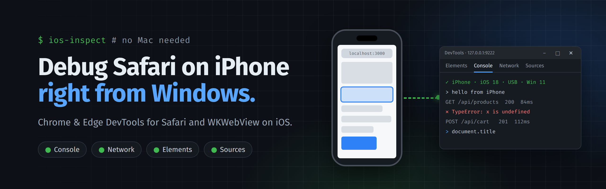

<p align="center">
  
</p>

# ios-inspect-windows

Debug websites in **Safari on iPhone** and in **WKWebView** straight from **Windows**, no Mac required.
You get the familiar Chrome DevTools: Console, Network, Elements, Sources.

```
iPhone (Safari)  ──USB──▶  ios-inspect  ──▶  Chrome / Edge DevTools on Windows
```

> Apple ships the iOS Web Inspector only inside Safari on macOS. `ios-inspect` uses
> [pymobiledevice3](https://github.com/doronz88/pymobiledevice3) to reach the Web Inspector
> service on the iPhone over USB and shows it in Chrome or Edge.
>
> On Linux? Use [ios-inspect-linux](https://github.com/raisulkhairi/ios-inspect-linux).

## Features

- **Console**: see `console.log` output and errors from the iPhone, run JavaScript in the page.
- **Network**: requests, responses, headers, status codes, timing.
- **Elements**: inspect the DOM and edit CSS live.
- **Sources**: browse JS files and set breakpoints.
- **One command**: waits for the iPhone, starts the bridge, and opens the browser for you.
- **Auto-reconnect**: if the cable comes loose, just plug it back in.
- **`ios-inspect doctor`**: checks your setup and tells you what to fix.

Not yet tested on a real Windows machine. If you try it, please
[open an issue](https://github.com/raisulkhairi/ios-inspect-windows/issues) with the output of
`ios-inspect doctor`, whether it works or not.

## Requirements

| Requirement | Notes |
|---|---|
| Windows 10 or 11 | |
| Python 3.9+ | From [python.org](https://www.python.org/downloads/windows/) or the Microsoft Store |
| **Apple Devices** app (or iTunes) | Installs the iPhone USB driver and *Apple Mobile Device Service* |
| Chrome / Edge / Brave | Displays DevTools. Edge comes with Windows |
| iPhone + data cable | Charge-only cables will not work |
| Internet access | The DevTools UI is downloaded when it opens |

## Installation

In PowerShell:

```powershell
# 1. Install "Apple Devices" from the Microsoft Store (or iTunes from apple.com)

# 2. Install ios-inspect into a virtualenv
py -m venv $HOME\.venvs\ios-inspect
& $HOME\.venvs\ios-inspect\Scripts\pip install git+https://github.com/raisulkhairi/ios-inspect-windows.git

# 3. (Optional) make `ios-inspect` available on your PATH for this user
[Environment]::SetEnvironmentVariable("Path", "$env:Path;$HOME\.venvs\ios-inspect\Scripts", "User")
```

Or with [pipx](https://pipx.pypa.io/):

```powershell
py -m pip install --user pipx
py -m pipx ensurepath          # then open a new terminal
pipx install git+https://github.com/raisulkhairi/ios-inspect-windows.git
```

## iPhone setup (one time)

1. Go to **Settings → Apps → Safari → Advanced** and turn on **Web Inspector**.
   (iOS 17 and earlier: **Settings → Safari → Advanced → Web Inspector**.)
2. Plug the iPhone into your PC, unlock it, and tap **Trust** when *"Trust This Computer?"* appears.
   The iPhone should now show up in the Apple Devices app.

## Usage

```powershell
ios-inspect
```

Then:

1. Open the website you want to debug in **Safari on the iPhone**.
2. Your browser opens `http://127.0.0.1:9222/` automatically and lists the inspectable pages.
3. **Click the page title** (the blue link). DevTools opens.
4. When you are done, press `Ctrl+C` in the terminal.

Example output:

```
Connected: iPhone (iPhone11,8, iOS 18.7.12, USB)
Web Inspector ready: http://127.0.0.1:9222/  (1 inspectable page)
Click a page title to open DevTools. Press Ctrl+C to stop.
```

> **Tip:** in the **Network** tab, reload the page on the iPhone after DevTools opens
> so that every request from the start is captured.

### Commands

| Command | What it does |
|---|---|
| `ios-inspect` | Start the Web Inspector (same as `ios-inspect start`) |
| `ios-inspect doctor` | Check Apple Mobile Device Service, the iPhone, Web Inspector, and the browser |
| `ios-inspect pages` | List Safari tabs that can be inspected |
| `ios-inspect devices` | List connected iPhones |

### `start` options

`start` is the default command, so these also work without it, e.g. `ios-inspect --no-browser`.

| Option | What it does |
|---|---|
| `--port 9333` | Use another port (default `9222`) |
| `--no-browser` | Do not open the browser automatically |
| `--no-reconnect` | Exit when the iPhone disconnects |
| `--pause-new-targets` | Pause every new JSContext on its first statement |
| `-v`, `--verbose` | Show bridge logs (for troubleshooting) |
| `--udid <UDID>` | Pick a specific iPhone when several are connected (put it before the subcommand) |
| `--browser <name or path>` | Use a specific browser, e.g. `--browser msedge` or the full path to its `.exe` |

### Debugging apps (WKWebView)

WKWebView pages inside an iOS app can be inspected when the app enables:

```swift
webView.isInspectable = true   // iOS 16.4+
```

### Using it from VS Code

Run `ios-inspect --no-browser`, then add this to `.vscode/launch.json`:

```json
{
  "type": "chrome",
  "request": "attach",
  "name": "iPhone Safari",
  "address": "127.0.0.1",
  "port": 9222,
  "urlFilter": "*",
  "webRoot": "${workspaceFolder}"
}
```

## Troubleshooting

Run `ios-inspect doctor` first. Common problems:

| Symptom | Fix |
|---|---|
| `Apple Mobile Device Service running` fails | Install **Apple Devices** (or iTunes) and restart. In `services.msc`, make sure *Apple Mobile Device Service* is running. |
| Stuck on `Waiting for an iPhone...` | Re-plug or try another USB port/cable, unlock the iPhone, tap **Trust**. Check that it appears in the Apple Devices app. |
| Stuck on `Bridge is still starting...` | Unlock the iPhone and keep Safari open. If it persists, stop and rerun with `--verbose` to see the bridge log. |
| The page list is empty | Make sure Web Inspector is on, a website is open in Safari, and the iPhone is unlocked, then refresh the list. |
| `iPhone disconnected` | The cable came loose. Plug it back in; `ios-inspect` reconnects on its own. |
| DevTools shows a blank page | Check your internet connection (the DevTools UI is downloaded when it opens). |
| Console freezes under heavy logging | Open DevTools from `http://127.0.0.1:9222/`, not from `chrome://inspect` or `edge://inspect`. |
| Page marked *held elsewhere*, Console/Network stay empty | The page is being debugged somewhere else (Safari on a Mac, or a second `ios-inspect`). Close that debugger first. |
| `Port 9222 is already in use` | Another `ios-inspect` (or a browser with remote debugging) holds the port. Stop it, or run `ios-inspect --port 9333`. |
| `ios-inspect` is not recognized | Open a new terminal after changing PATH or running `pipx ensurepath`. |

## Limitations

- The iOS Simulator is not supported (it needs Xcode/macOS).
- USB only; debugging over Wi-Fi has not been tested.
- Apple may change the Web Inspector protocol in new iOS releases. If something breaks,
  try updating pymobiledevice3: `pip install -U pymobiledevice3` (inside the venv).

## How it works

`ios-inspect` itself is only a launcher. The heavy lifting (talking to the iPhone and translating
the protocol) is done by [pymobiledevice3](https://github.com/doronz88/pymobiledevice3).

```
┌─ iPhone ───────────────┐     ┌─ Windows PC ─────────────────────────────────────┐
│ Safari / WKWebView     │     │                                                  │
│        │               │     │  Apple Mobile   pymobiledevice3       Chrome /   │
│ webinspectord ◀────────┼─USB─┼─▶ Device   ──▶  webinspector cdp ◀──▶ Edge       │
│ (Web Inspector service)│     │    Service      • talks to the iPhone DevTools   │
└────────────────────────┘     │    (:27015)     • translates protocol (Console,  │
                               │                 • serves :9222        Network…)  │
                               │        ▲                                         │
                               │  ios-inspect: starts, watches, opens the         │
                               │               browser, reconnects                │
                               └──────────────────────────────────────────────────┘
```

### Four layers

1. **iPhone: `webinspectord`.** The built-in iOS service that Safari on a Mac also talks to. It is
   active only when **Web Inspector** is enabled in Settings, and it tracks every Safari and
   WKWebView page that may be inspected.
2. **USB link: Apple Mobile Device Service.** Installed with the Apple Devices app or iTunes, it
   plays the role `usbmuxd` plays on Linux: it owns the USB link to the iPhone and listens on
   `127.0.0.1:27015`. After pairing (tapping **Trust**), the PC may open services on the iPhone,
   including Web Inspector.
3. **Translator: `pymobiledevice3 webinspector cdp`.** The core of the system. It:
   - opens the Web Inspector service, asks for the list of apps and pages, and connects to the
     page you pick;
   - translates in both directions between the **WebKit Inspector Protocol** (what the iPhone
     speaks) and the **Chrome DevTools Protocol / CDP** (what Chrome and Edge DevTools speak);
   - serves `127.0.0.1:9222`:

     | Endpoint | Contents |
     |---|---|
     | `/` | Page list |
     | `/json` | Target list for Chrome, Edge, VS Code, Playwright, etc. |
     | `ws://…/devtools/page/<id>` | Per-page WebSocket that carries DevTools messages |
     | `/devtools/inspector.html` | The DevTools UI (downloaded from the internet) |
4. **Display: Chrome or Edge DevTools.** Plain DevTools. To it, `127.0.0.1:9222` looks like any
   other Chromium browser, so it never needs to know there is an iPhone on the other end.

### Example flow: one `console.log`

```
iPhone: the page runs console.log("hello")
  → webinspectord sends an event (WebKit protocol) over USB
  → Apple Mobile Device Service forwards it to pymobiledevice3
  → it is translated into the CDP event "Runtime.consoleAPICalled"
  → sent over the WebSocket to DevTools
  → "hello" appears in the Console tab
```

It works the other way too: a command typed into the Console (for example `document.title`) is
translated, run on the iPhone, and the result is sent back. The Network, Elements, and Sources
tabs work the same way.

### What `ios-inspect` does

Code in [`src/ios_inspect/cli.py`](src/ios_inspect/cli.py):

```
start
  └─▶ wait for the iPhone to appear in Apple Mobile Device Service (polls every 2 seconds)
        └─▶ run "pymobiledevice3 webinspector cdp" as a child process (own process group)
              └─▶ wait for the :9222 server to be ready (polls /json/version)
                    └─▶ open Chrome / Brave / Edge at http://127.0.0.1:9222/ (once)
                          └─▶ wait for the bridge to exit
                                ├─ iPhone disconnected        → back to "wait for the iPhone"
                                ├─ error, iPhone still there  → retry after 5 seconds
                                └─ Ctrl+C                     → stop the bridge and exit
```

- `doctor` checks pymobiledevice3, Apple Mobile Device Service, the iPhone, the Web Inspector
  response, and the browser, one by one.
- `pages` and `devices` print data from pymobiledevice3.

### Windows specifics

- **Browser lookup.** Windows installers do not put browsers on PATH, so `ios-inspect` looks in
  `%ProgramFiles%`, `%ProgramFiles(x86)%` and `%LocalAppData%` for Chrome, Brave and Chromium, and
  falls back to Edge, which every Windows install has.
- **Ctrl+C.** The bridge runs in its own process group, so Ctrl+C reaches only `ios-inspect`, which
  then stops the bridge itself. Otherwise the bridge would exit on its own and be restarted as if
  it had crashed.
- **Encoding.** pymobiledevice3 runs in UTF-8 mode, so device names and page titles with
  non-ASCII characters do not break on consoles that use another code page.

### Design consequences

- **One page, one debugger.** A page already held by another debugger (Safari on a Mac, or a
  second bridge) is marked *held elsewhere* and sends no events to our DevTools.
- **Depends on pymobiledevice3.** If Apple changes the protocol in a new iOS release, it is
  pymobiledevice3 that needs updating, not `ios-inspect`.
- **The DevTools UI comes from the internet**, so without a connection it may show a blank page.

## License

[GPL-3.0-or-later](LICENSE). This project uses
[pymobiledevice3](https://github.com/doronz88/pymobiledevice3) (GPL-3.0).
